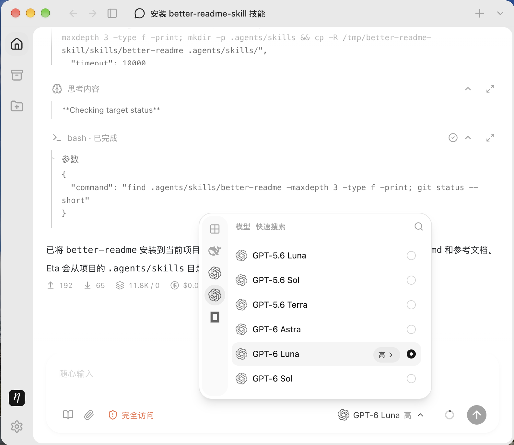

<p align="center">
  
</p>
<h1 align="center">Eta</h1>
<p align="center">A general-purpose agent for your desktop — and your cloud.</p>
<p align="center">English · <a href="README.zh-CN.md">简体中文</a></p>

Eta turns natural-language instructions into finished work: explore a codebase, edit documents, reorganize a workspace, or run a recurring job. One agent, three ways to reach it — a desktop app for local work, a self-hosted Bot that keeps working in the cloud around the clock, and a mobile companion for following along and answering approvals from anywhere.

Give Eta a project and a task. Conversations are durable: close the app, put the phone away, or come back tomorrow — the work, its history, and its schedules are exactly where you left them.



## Getting started

### Desktop

Download an installer from [GitHub Releases](https://github.com/Lingwcy/eta/releases). Eta updates itself in place.

| Platform              | Installer                     |
| --------------------- | ----------------------------- |
| macOS — Apple Silicon | `Eta-<version>-mac-arm64.dmg` |
| macOS — Intel         | `Eta-<version>-mac-x64.dmg`   |
| Windows — x64         | `Eta-<version>-win-x64.exe`   |

The Windows x64 installer is currently unsigned; SmartScreen may warn on first launch. Local command execution requires Git for Windows (including Git Bash), and restricted sandbox execution is not supported on Windows. See the [release notes](docs/release.md) and [sandbox guide](docs/user/sandbox.md).

Connect an AI account or bring your own API key, choose a project folder, and describe the work. See [Working with Eta](docs/user/desktop.md) for chats, projects, skills, subagents, and scheduled tasks.

### Cloud — Eta Bot

Run Eta on your own server and reach the same agent from Desktop or mobile. Before the first run, copy `apps/bot/config.example.json` to `apps/bot/config.json` and set a private administrator token; project directories live under `apps/bot/workspaces`. Deploy the Bot with Docker:

```sh
docker compose -f apps/bot/compose.example.yaml up --build -d
```

Then connect from **Settings → Application → Bot** in Desktop, import your model credentials, and switch a new chat's execution location from "This computer" to "Cloud". Cloud work uses the server's files, models, and skills — and it keeps running after Desktop closes, schedules included. The Bot also accepts work over its HTTP API and can receive customer issues from Discord. Full deployment guide: [apps/bot/README.md](apps/bot/README.md); user guide: [Connect a Bot (中文)](docs/user/bot.md).

### Mobile

eta-mobile for iOS and Android connects to your Bot: start conversations, follow tool results as they happen, and answer approval requests from your phone. Work continues on the server when you disconnect. See the [mobile guide (中文)](docs/user/mobile.md).

## What Eta does

- **Durable conversations and projects** — saved chats with full history, per-project workspaces, optional Git worktrees for isolated work, and a GitHub panel for browsing a project's pull requests and issues.
- **Subagents** — delegate work to child conversations, follow their progress, and steer them mid-flight. Presets carry their own instructions, thinking levels, and models; in orchestrator mode the main conversation coordinates while children execute.
- **Skills** — reusable instructions the agent loads on demand. Invoke one with `$skill-name`; keep personal skills in `~/.agents/skills/` and project skills in `.agents/skills/`.
- **Scheduled tasks** — one-time, interval, daily, or weekly plans attached to a chat. Run them locally, or on the Bot, where they fire on the server even while Desktop is closed.
- **Approvals that scale** — every action outside the current policy shows exactly what it wants to do before it runs. Answer yourself on Desktop or mobile, or let an automatic reviewer model approve, deny, or hand the request back to you.

## Permissions & sandboxing

Eta ships with a real permission system. Each chat runs under one of three policies — **read-only**, **workspace sandbox** (the default), or **full access** — enforced by native sandbox backends (Seatbelt on macOS, Landlock on Linux) across file tools, commands, and subprocesses. Anything outside the policy needs a grant first: approval cards spell out the operation, its arguments, and the extra file or network scope, and grants are scoped to a single call or a single run. Bot deployments set their own policy ceiling for every connected client. If a sandbox backend is unavailable, the task is blocked with an explanation — Eta never widens access on its own. See the [sandbox policies (中文)](docs/user/sandbox.md).

## Packages

This monorepo contains the Eta clients and the shared core they all run on.

| Part               | Description                                                                   |
| ------------------ | ----------------------------------------------------------------------------- |
| **apps/desktop**   | Electron client for macOS and Windows — the full local agent experience       |
| **apps/bot**       | Self-hosted cloud server hosting the agent over HTTP/SSE, with Discord intake |
| **apps/mobile**    | iOS and Android companion for a deployed Bot                                  |
| **packages/core**  | Shared core: projects, durable threads, sandboxing, scheduling, approvals     |
| **packages/agent** | Agent runtime with tool calling and session management                        |

Eta's agent runtime is built on [Pi](https://github.com/earendil-works/pi), the minimal, extensible agent harness from Earendil Works.

## Contributing

See [CONTRIBUTING.md](CONTRIBUTING.md) for development setup, focused checks, and installer builds. Maintainers publish releases using the [release guide](docs/release.md).

## Development

```sh
vp install        # Install dependencies with the Vite+ toolchain
vp run dev        # Build and run the desktop app
vp run @eta/bot#build   # Build the Bot server
vp run package:mac      # Build a macOS installer
vp run package:win      # Build a Windows installer
```

## License

[MIT](LICENSE). Dependencies and bundled assets retain their own licenses.
