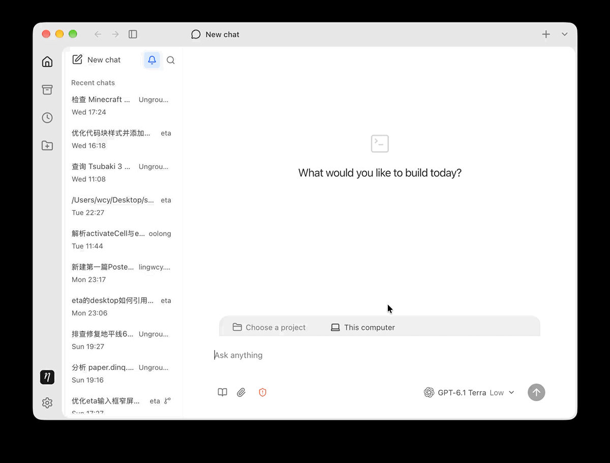

<p align="center">
  
</p>
<h1 align="center">Eta</h1>
<p align="center">
  <a href="https://github.com/Lingwcy/eta/stargazers"></a>
  <a href="https://github.com/Lingwcy/eta/releases"></a>
  <a href="https://github.com/Lingwcy/eta/releases"></a>
  <a href="https://github.com/Lingwcy/eta/blob/main/LICENSE"></a>
  
</p>
<p align="center">A general-purpose agent for your desktop — and your cloud.</p>
<p align="center">English · <a href="README.zh-CN.md">简体中文</a></p>

Eta isn't trying to outgrow the giants or replace the tools you already love. It is a small, open-source personal agent built to stay transparent, sharp, and quietly at home on your desktop.

Instead of locking you into one vendor or one window, Eta takes the shape of your workflow — your models, your local files, your skills — and flows across three places: a desktop app for hands-on work, a self-hosted Bot that keeps running after you close the lid, and a phone companion for approvals on the go, with durable conversations and scheduled work across all three.



## Getting started

Download an installer from [GitHub Releases](https://github.com/Lingwcy/eta/releases). Eta updates itself in place.

The Windows x64 installer is currently unsigned; SmartScreen may warn on first launch. Local command execution requires Git for Windows (including Git Bash), and restricted sandbox execution is not supported on Windows. See the [release notes](docs/release.md) and [sandbox guide](docs/user/sandbox.md).

Connect an AI account or bring your own API key, choose a project folder, and describe the work. See [Working with Eta](docs/user/desktop.md) for chats, projects, skills, subagents, and scheduled tasks. For extended deployments with a self-hosted Bot or the mobile companion, see the [Bot deployment guide](apps/bot/README.md), [Connect a Bot (中文)](docs/user/bot.md), and the [mobile guide (中文)](docs/user/mobile.md).

## Packages

This monorepo contains the Eta clients and the shared core they all run on.

| Part               | Description                                                                   |
| ------------------ | ----------------------------------------------------------------------------- |
| **apps/desktop**   | Electron client for macOS and Windows — the full local agent experience       |
| **apps/bot**       | Self-hosted cloud server hosting the agent over HTTP/SSE, with Discord intake |
| **apps/mobile**    | iOS and Android companion for a deployed Bot                                  |
| **packages/core**  | Shared core: projects, durable threads, sandboxing, scheduling, approvals     |
| **packages/agent** | Agent runtime with tool calling and session management                        |

Eta's agent runtime is built on [Pi](https://github.com/earendil-works/pi), the minimal, extensible agent harness from Earendil Works.

## Contributing

See [CONTRIBUTING.md](CONTRIBUTING.md) for development setup, focused checks, and installer builds. Maintainers publish releases using the [release guide](docs/release.md).

## Development

```sh
vp install        # Install dependencies with the Vite+ toolchain
vp run dev        # Build and run the desktop app
vp run @eta/bot#build   # Build the Bot server
vp run dev:website     # Run the Astro product website
vp run build:website   # Build the static website
vp run package:mac      # Build a macOS installer
vp run package:win      # Build a Windows installer
```

## License

[MIT](LICENSE). Dependencies and bundled assets retain their own licenses.
