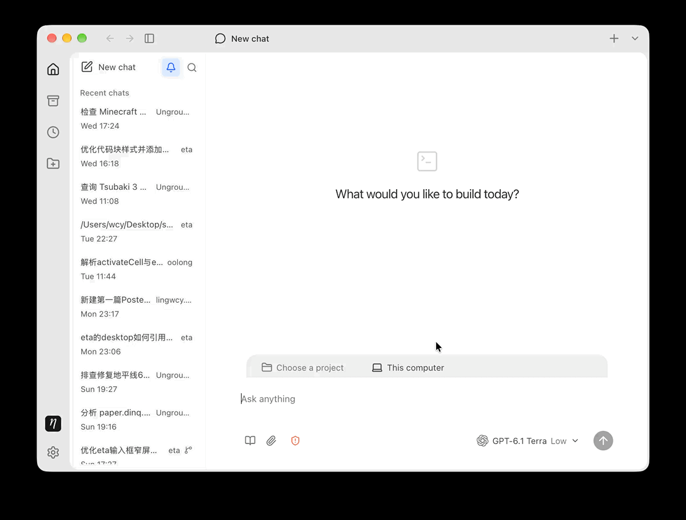

<p align="center">
  
</p>
<h1 align="center">Eta</h1>
<p align="center">
  <a href="https://github.com/Lingwcy/eta/stargazers"></a>
  <a href="https://github.com/Lingwcy/eta/releases"></a>
  <a href="https://github.com/Lingwcy/eta/releases"></a>
  <a href="https://github.com/Lingwcy/eta/blob/main/LICENSE"></a>
  
</p>
<p align="center">桌面与云端通用的 Agent。</p>
<p align="center"><a href="README.md">English</a> · 简体中文</p>

Eta 不试图与大厂产品比拼体量，也不想取代你已经顺手的工具。它只是一个真正开源、透明、小巧且持续精进的个人桌面代理——安静地留在你的桌面上，随叫随到。

它不把你锁进某一家模型或某一种单一形态，像水一样顺应你的工作流：装进你的模型、你的本地目录与你的技能，在三个地方自然流动——桌面端处理手头的工作，自托管的 Bot 在合上电脑后继续运行，手机端在路上随时审批；持久的会话与定时任务在三端之间无缝延续。



## 快速开始

从 [GitHub Releases](https://github.com/Lingwcy/eta/releases) 下载安装包，Eta 会自动更新到新版本。

Windows x64 安装包目前未签名，首次安装可能出现 SmartScreen 提示。Windows 命令执行工具需安装 Git for Windows（含 Git Bash）；当前 Windows 不支持受限沙盒执行。详见[发布说明](docs/release.md)和[沙盒指南](docs/user/sandbox.md)。

连接 AI 账户或填入自己的 API Key，选择项目文件夹，然后描述要做的工作。会话、项目、技能、子智能体和定时任务的用法见[桌面端指南](docs/user/desktop.zh-CN.md)。如需扩展部署自托管 Bot 或接入手机端，请参阅 [Bot 部署说明](apps/bot/README.md)、[连接 Bot](docs/user/bot.md) 与[手机端指南](docs/user/mobile.md)。

## 仓库结构

本仓库包含 Eta 的各端应用与它们共享的核心。

| 部分               | 说明                                                        |
| ------------------ | ----------------------------------------------------------- |
| **apps/desktop**   | macOS 与 Windows 的 Electron 客户端，完整的本地 Agent 体验  |
| **apps/bot**       | 自托管云端服务，通过 HTTP/SSE 托管 Agent，支持 Discord 接入 |
| **apps/mobile**    | iOS 与 Android 手机端，连接已部署的 Bot                     |
| **packages/core**  | 共享核心：项目、持久会话、沙盒、定时任务、审批              |
| **packages/agent** | Agent 运行时：工具调用与会话管理                            |

Eta 的 Agent 运行时基于 Earendil Works 的 [Pi](https://github.com/earendil-works/pi) —— 一个极简、可扩展的 Agent 框架。

## 参与开发

开发环境、聚焦检查与安装包构建见 [CONTRIBUTING.md](CONTRIBUTING.md)。维护者按[发布指南](docs/release.md)发布版本。

## 开发命令

```sh
vp install        # 用 Vite+ 工具链安装依赖
vp run dev        # 构建并运行桌面端
vp run @eta/bot#build   # 构建 Bot 服务
vp run dev:website     # 启动 Astro 产品官网
vp run build:website   # 构建静态官网
vp run package:mac      # 构建 macOS 安装包
vp run package:win      # 构建 Windows 安装包
```

## 许可证

[MIT](LICENSE)。依赖与捆绑资源保留各自的许可证。
