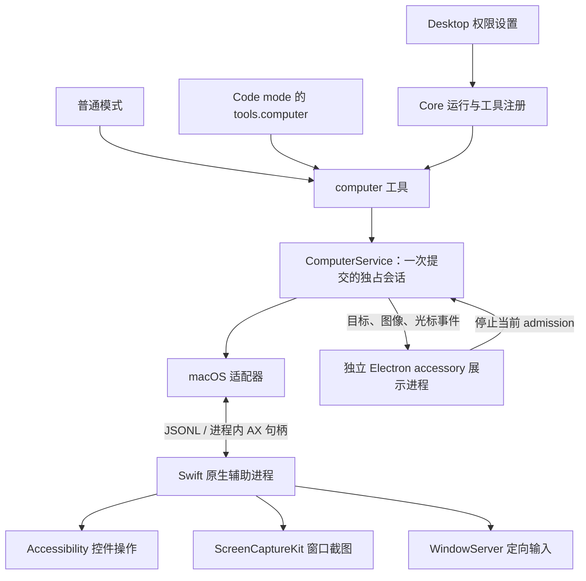

# Computer Use 的进程边界与输入所有权

Computer Use 是 Desktop 提供给 Core 的本机能力。独立的 `@eta/computer-use` 包持有桌面会话，Core 将它绑定到一次主 agent 提交；Electron 负责系统授权、原生程序路径和展示。这样不会把平台代码带入从 Pi Durable 同步的 `packages/agent`，Bot 等未注入宿主能力的环境也不会注册可用的桌面工具。

## 一次提交拥有控制权，thread ID 不拥有

[Core 运行适配](../../packages/core/src/computer/runtime.ts)以根 conversation 当前运行的首个提交标识创建独立 owner 对象。同一次运行的模型 generation 会交接，task ID 因此不能作为桌面所有者；只有 thread ID 又会让旧任务借用新任务的截图。owner 同时核对运行中的提交、对象身份和权限状态。子 agent 不获取这项能力，orchestrator 的桌面操作也由主 agent 执行。

同一 Desktop 实例共享一个 [ComputerService](../../packages/computer-use/src/service.ts)，并发调用返回忙碌，不排队执行过时坐标。每次输入绑定最近一次观察的 frame；控件编号只在该观察内有效。坐标按实际交付图片的尺寸映射到窗口逻辑坐标，不能直接使用 Retina 原始像素或宿主浮窗的尺寸。完整路径在发送第一个事件前完成转换和范围校验，纯参数错误不消费原 frame；开始原生输入前则使 frame 失效，因为失败可能已经产生效果。

停止运行、关闭权限、禁止图片及关闭浮窗都会撤销对应 admission。取消先阻止新输入，再等待在途操作与原生释放完成，之后才允许替代 owner。原生进程通过 SIGTERM 协作退出，在清理路径中向原接收者释放按住的键鼠；强杀或无法确认清理会使宿主拒绝继续使用该 helper。用户接管目标应用后，同一 admission 的 observe、open、release 后重入也不能恢复控制。持久历史保存观察和工具结果，不能恢复 AX 句柄或重放输入。

## 后台输入不是虚拟桌面

当前实现操作真实 macOS 登录会话中的真实窗口，没有虚拟机、独立登录桌面或第二套系统鼠标。[原生事件适配](../../packages/computer-use/native/DirectedEvents.swift)使用私有 CGEventSource 状态、PID 定向事件与目标窗口位置，避免移动物理光标。控件有 AXPress 时调用主动作，没有时选择已校验控件中心的定向点击；执行结果不确定的 AX 动作不自动回退重试。

PID 只能标识应用，不能证明键盘仍属于所选窗口。输入继续校验原生 window ID、窗口几何、AX 控件身份及父链；ViewBridge 控件还需绑定实际接收进程。目标应用的另一个窗口正被用户在前台使用时，直接拒绝输入。窗口匹配不能以位置相同代替身份相同。

后台应用的菜单仍可能临时取得键盘焦点或抬高窗口。[焦点保护](../../packages/computer-use/native/FocusGuard.swift)跟踪真实 WindowServer 所有权，并在目标及 helper 的事件路由内归还原样键盘事件，不解析键内容。排序恢复只允许 AXRaise 仍是同一前台、且起初遮挡目标的那个窗口；用户切换应用、窗口或打开系统面板后放弃恢复，不激活应用。这是经维护者接受的事后纠正，不能承诺零帧闪动。

这些操作依赖 macOS 私有符号；符号缺失时报告不可用，不切换到全局 HID 输入。系统必须已登录并解锁。当前支持 macOS 14+，不同应用对后台事件的支持仍有差异，事件投递成功不能证明任务完成。单显示器跨 Space 已验收，物理多显示器并行使用尚未验收。

## 观察、模型图像与宿主展示分别持有状态

控件树足够时，模型只接收 AX 文本；需要视觉判断时才请求窗口截图，坐标由当前聊天模型给出，没有额外 grounding 模型。主窗口位于其他 Space 时，macOS 14.2+ 截图明确排除子窗口，以绕过实测的 ScreenCaptureKit 子窗口捕获失败。`excludesChildWindows` 必须随 frame 进入两种模式的提示；菜单继续通过 AX 编号操作，不能因截图没有菜单就判断菜单已关闭。

输入后的截图使用有截止时间的视觉稳定采样，它只表示像素暂时安静。应用加载、发送或保存完成需要从实际 UI 结果判断。连续拖拽的整条已知路径使用一次 down/up，只在结束后观察；未知的下一目标仍需先观察。

[工具结果](../../packages/core/src/computer/extension.ts)同时提供文本元数据和图像块：普通模式直接交付模型，Code mode 通过 `image(result.image)` 输出图像；`text(result)` 会把 base64 当文本处理，不是图片透传。Core 按摘要只限制标记为 Computer Use 的最近四张模型输入图片，不删除持久历史，也不裁剪其他工具或用户图片。嵌套调用的预览省略 base64，不能把预览截断误判为完整结果丢失。

浮窗是供用户查看的宿主观察，不授予输入能力、不生成模型 frame。没有绘制软件光标的视觉结果可以复用到浮窗；其他调用获取小尺寸、无光标的宿主预览，避免旧光标残留在实时标记下面。AX-only 调用保持模型结果无图。图像随观察更新，光标随实际输入事件更新，没有持续录屏或持续重绘循环。原生层判断目标在当前 Space 是否可见、是否被其他窗口遮挡；隐藏目标只在预览里显示操作位置，不把其坐标画在用户当前内容上。

[展示进程](../../apps/desktop/src/main/computer/overlay-process.ts)必须独立：在主 Electron 进程中改变 all-Spaces/accessory 策略，曾使其现有全屏窗口切换 Space。子进程仅接收展示事件，停止消息绑定原 admission；旧子进程的退出或迟到消息不能停止新运行。展示进程退出后按实际 exit 清理，不能等待可能被 Electron 后代继承的 stderr 句柄。

## 验证范围

独立包测试覆盖 frame、并发、取消、坐标和 JSONL 协议；原生纯策略测试覆盖窗口身份、焦点、输入归属、路径与排序；Core 测试覆盖普通模式和 Code mode 的图片、运行交接、开关与子 agent 限制。Desktop 测试覆盖权限控件、IPC 和展示进程生命周期。原生构建产物须在隔离目录执行 self-test，并保留第三方许可；类型检查不能证明安装包包含可用的双架构 helper。

真实 UI 验收须使用专用窗口，检查实际文字、选择或画布变化，同时核对前台、键盘归属、Space 与物理光标。夹具不能通过激活或聚焦目标来制造“后台输入成功”。已有真机证据覆盖跨 Space 窗口、菜单、Hosted 控件、Unicode 输入、滚动、连续拖拽及停止释放；它不证明所有应用兼容，也不构成真实模型速度或定位准确率基准。
