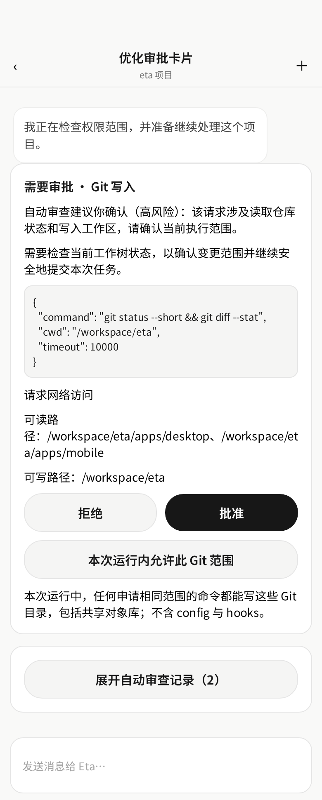
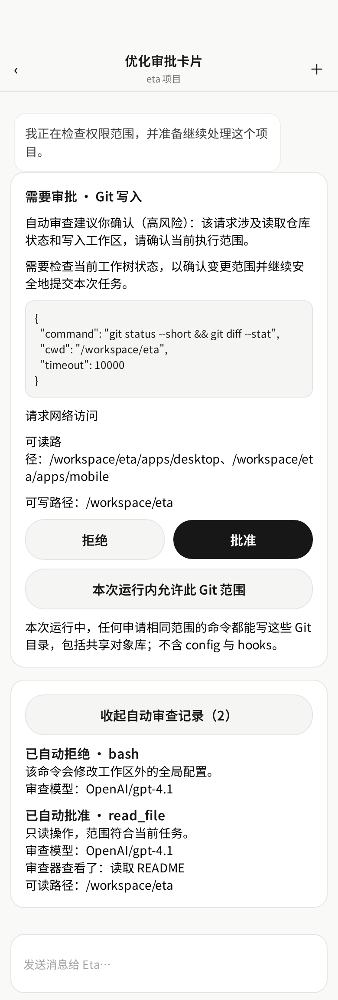

# UI review evidence

Component-level Playwright renders with representative fixture data. “Before” uses component code from `a5c2316` (unchanged in the rebased base `1104761`); “after” uses `030a246`. Desktop was rendered at 1100×680 CSS px; mobile at 390×844 CSS px (2× device scale).

## Desktop tab-list menu

| Before (`a5c2316`) | After (`030a246`) |
|:--:|:--:|
|  |  |

## Mobile approval card

| Before (`a5c2316`) | After (`030a246`) |
|:--:|:--:|
|  |  |

## Mobile automatic-review history

| Before (`a5c2316`) | After (`030a246`), compact rows |
|:--:|:--:|
|  |  |

Expanded details for one history item remain available on demand:

