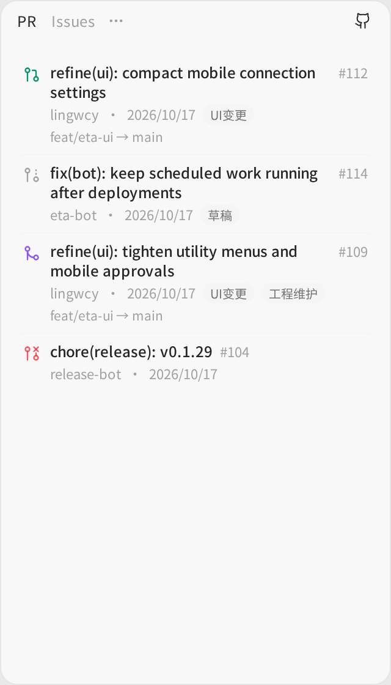
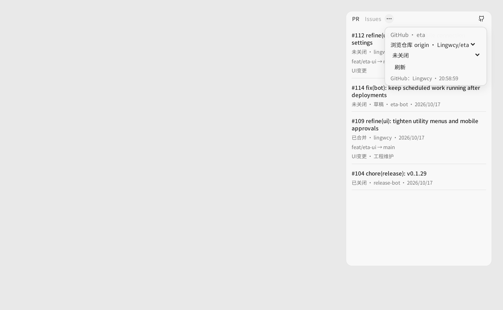
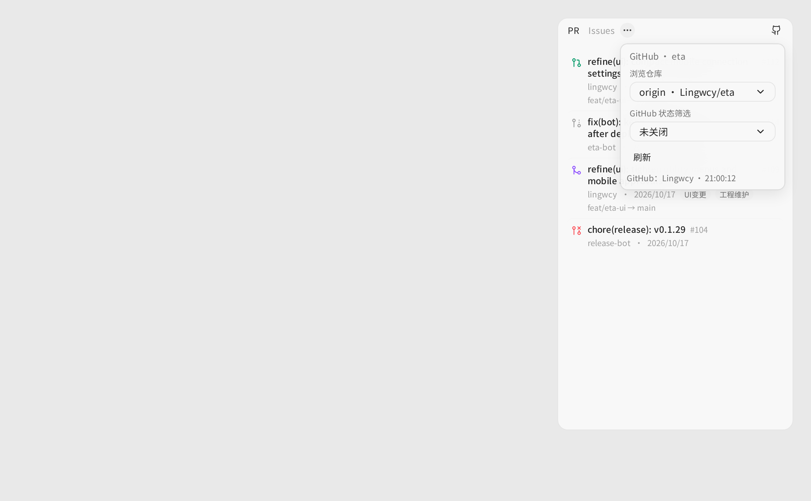

# GitHub inspector panel

The GitHub list was the plainest surface in the desktop app: bold underlined titles in a "#number title" run, a paragraph of state text, a comma-joined label list, hairline block borders, and two raw native `<select>` elements inside the menu popover. It now uses Eta's compact row treatment.

- State icon per row (open / draft / merged / closed) with matching tone.
- Title clamps to two lines with the number right-aligned in tabular figures.
- One meta line: author · updated date · label chips; the branch line renders in mono.
- Row hover surface instead of block separators; “load more” is a quiet full-width row.
- The popover's remote and state pickers now use the app `Select` in menu styling instead of unstyled native selects.

Component-level Playwright render of the real `GitHubPanel` with fixture data, captured at 1100×680 CSS px (2× device scale), 320px inspector column. “Before” is `3c4f133`; “after” is this PR.

| Before | After |
|:--:|:--:|
|  |  |

| Options before | Options after |
|:--:|:--:|
|  |  |
