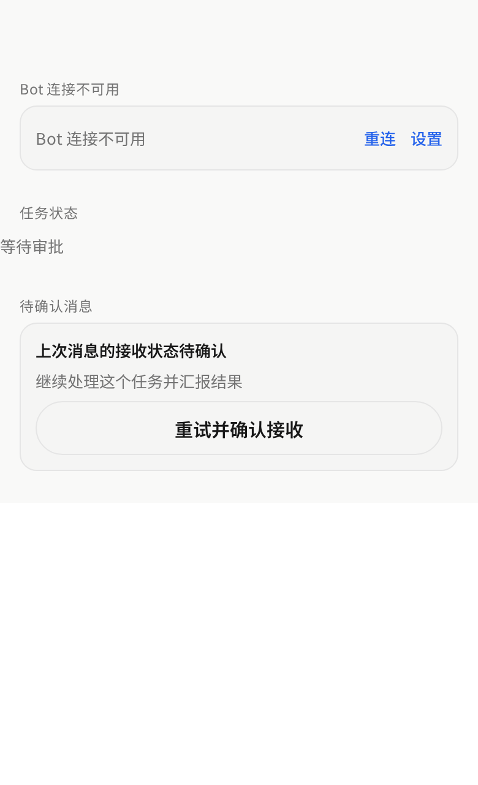
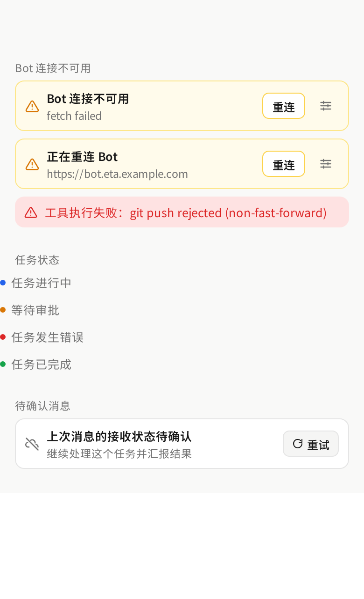

# Mobile chat status feedback

The chat screen used three unrelated, plain treatments for connection, task, and unsent-message state: a flat card with two bare blue text links, a single unbranded line of grey text, and a stack with a full-width pill button.

They are now one compact status language:

- **Connection banner** — amber strip with an alert icon, a title plus the failing detail, a small “重连” button, and an icon-only settings entry. A connected-but-failing Bot shows a single-line red error strip instead.
- **Task status** — one line with a tone dot (running, waiting, failed, done) so operation state reads at a glance.
- **Pending send** — one row with the cloud-off icon, the pending prompt, and a compact “重试” button that only appears once sending has settled.

Tone mapping lives in `taskTone()` and is covered by `apps/mobile/src/components/chat-status.test.ts`.

Component-level React Native Web render with representative fixture data, captured at 390×640 CSS px (2× device scale). “Before” renders the previous chat markup from `ed7f105`; “after” renders the new components from this PR.

| Before | After |
|:--:|:--:|
|  |  |
