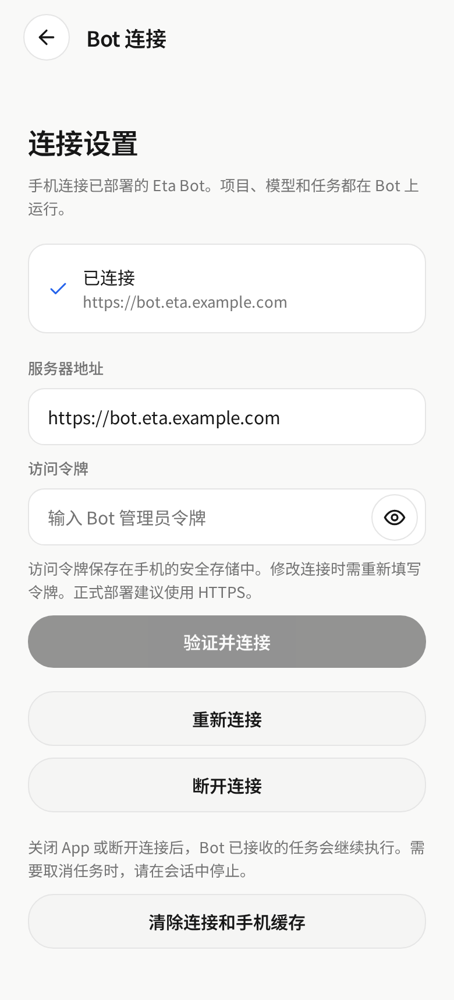
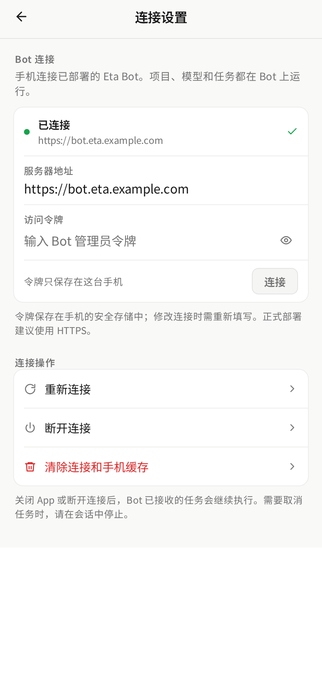

# Mobile connection settings

The connection screen used a 24px hero heading, free-standing cards, and four full-width pill buttons. It now follows the compact, grouped treatment used by the thread menu: one inset surface for status, endpoint, token, and the primary action; a second for connection actions; 46px action rows keep touch targets comfortable.

Component-level React Native Web render with representative fixture data. “Before” is `fde9cfd`; “after” is this PR. Captured at 390×844 CSS px (2× device scale), light appearance.

| Before | After |
|:--:|:--:|
|  |  |

First-run onboarding keeps the same compact form:

